# Famous Faces – Then & Now 0001 — review of actual retained files

**All 20 photographs are actual stored WebP files on this branch**, 720×720 pixels and under QuizPro's 140 KB file target, with a source/author/licence JSON record for each.

**IMPORTANT:** These images are *new licensed-source alternatives*. They are not the same photographs approved in the nine earlier review rounds. Existing approvals remain untouched until these specific saved images are explicitly approved by the user.

| Question | Then (actual saved file) | Now (actual saved file) |
|---|---|---|
| **1. Richard Branson** | 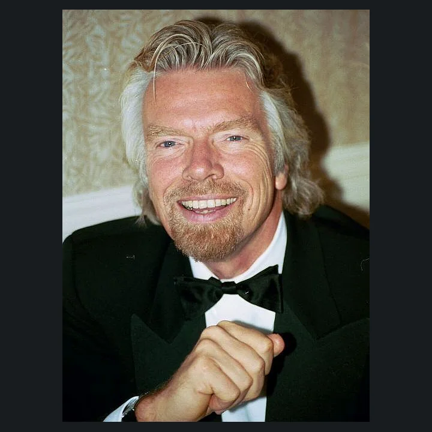 |  |
| **2. Kylie Minogue** | 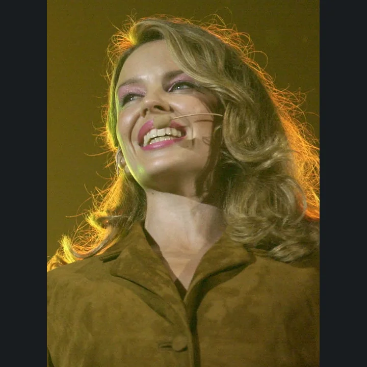 | 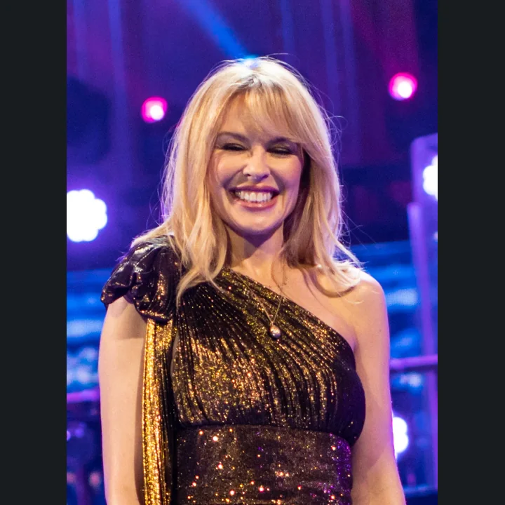 |
| **3. Robbie Williams** | 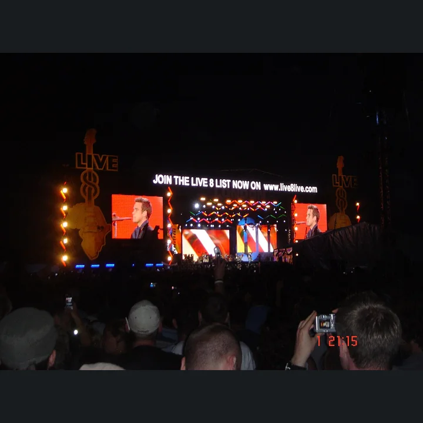 | 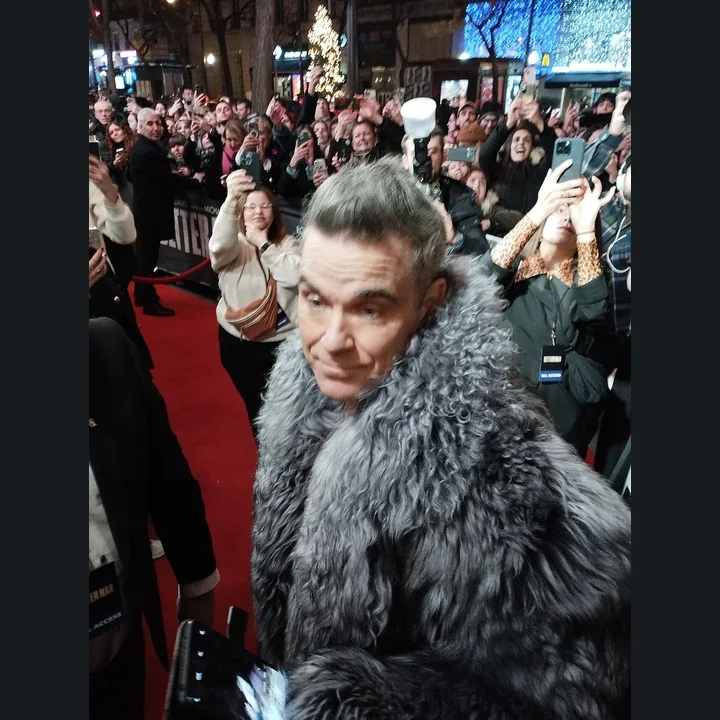 |
| **4. Tom Jones** | 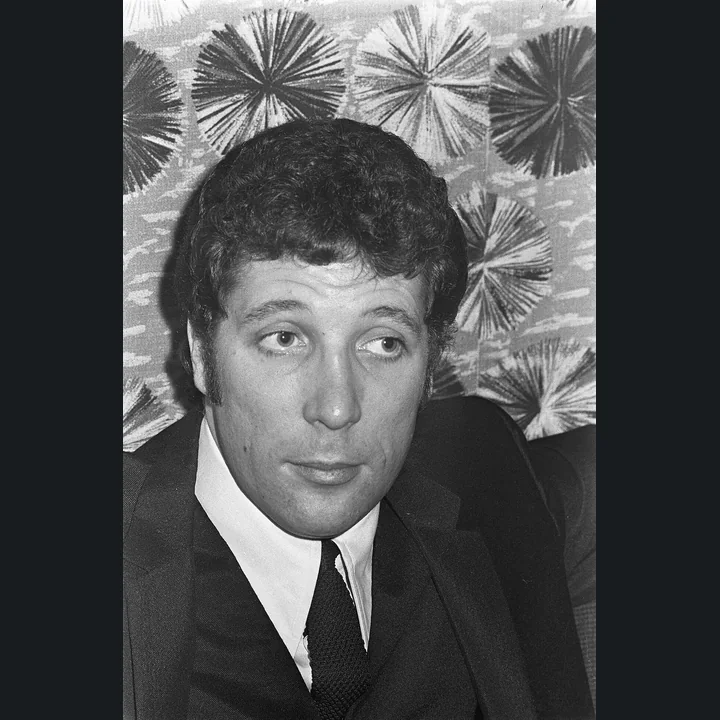 | 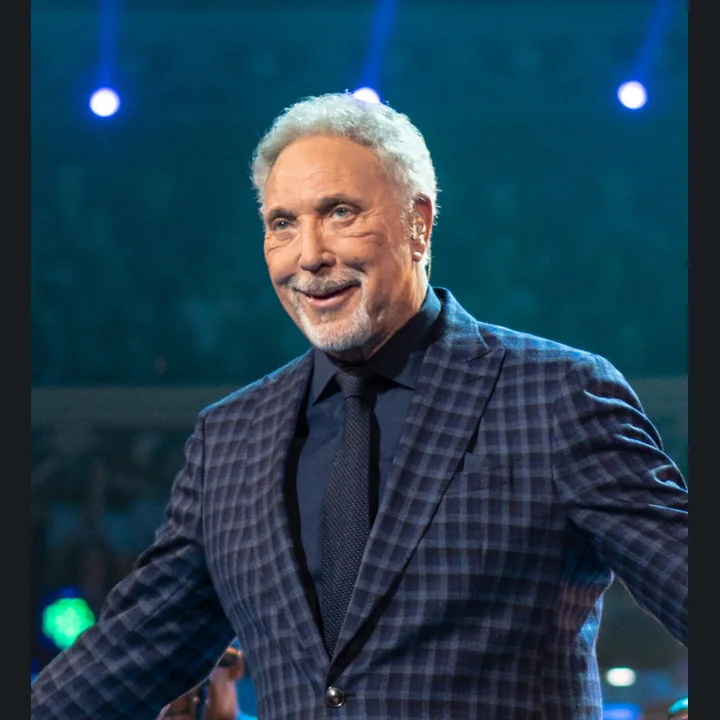 |
| **5. Samuel L. Jackson** | 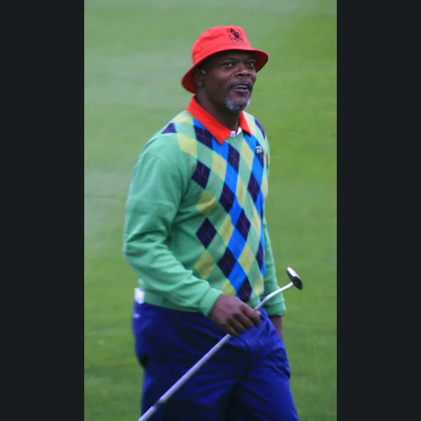 | 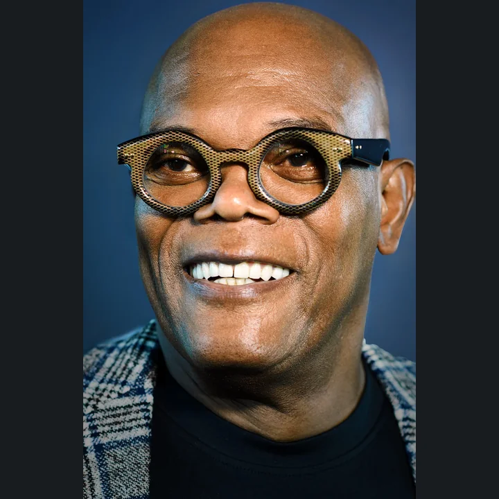 |
| **6. Emma Thompson** | 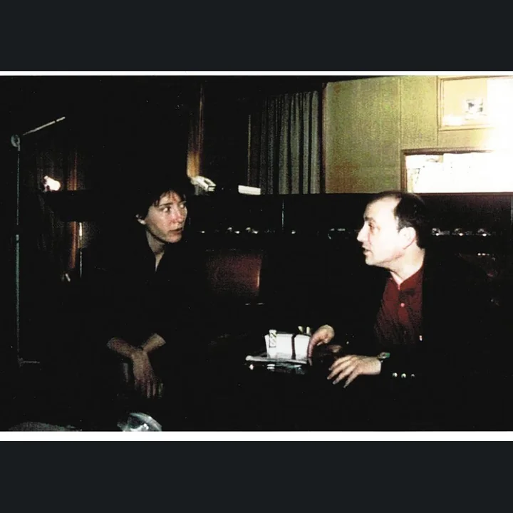 | 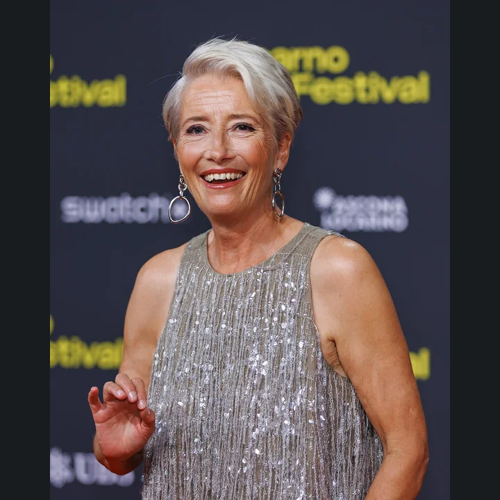 |
| **7. Daniel Radcliffe** | 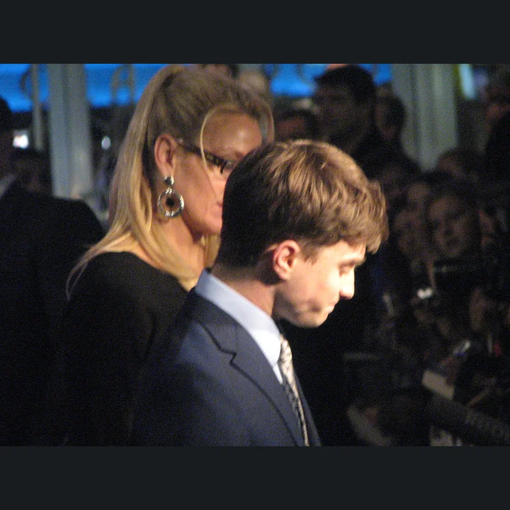 | 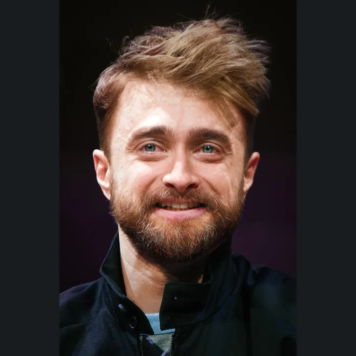 |
| **8. Gary Barlow** | 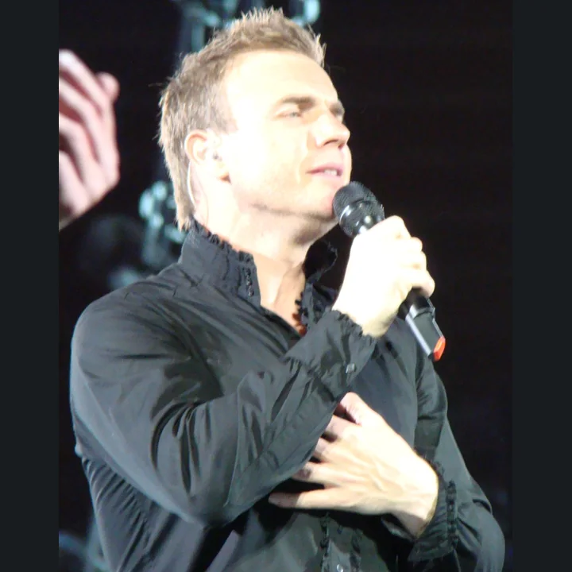 | 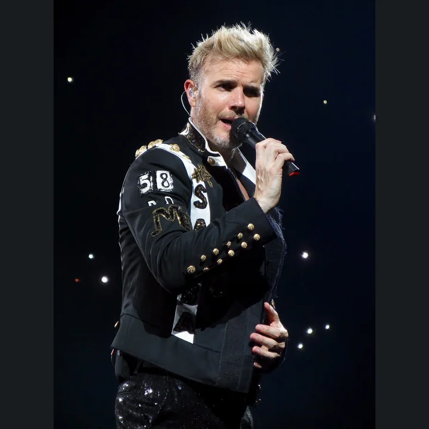 |
| **9. Joan Collins** | 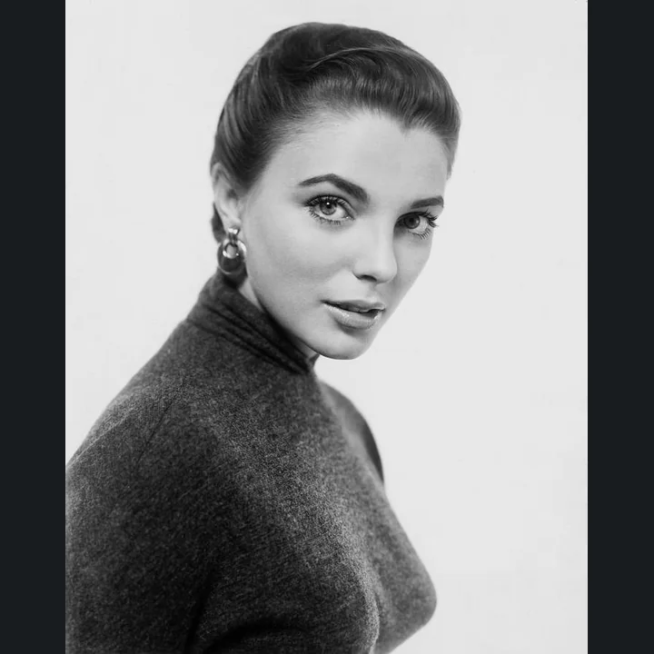 | 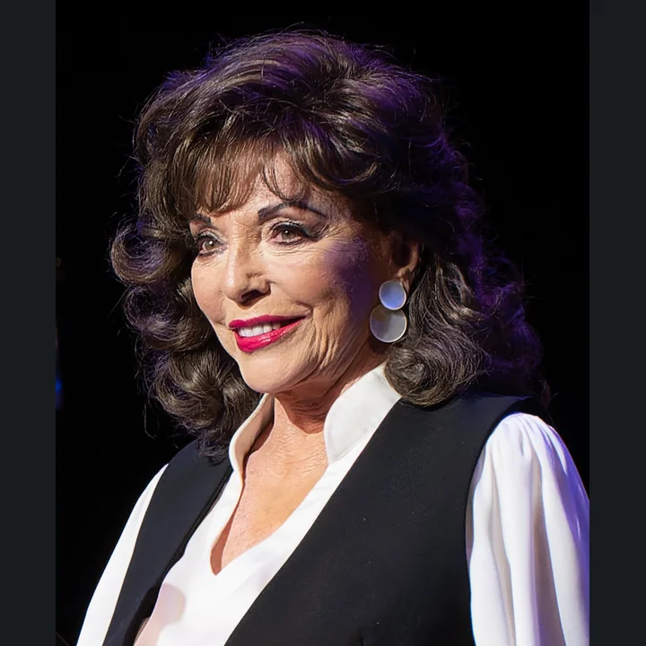 |
| **10. Helen Mirren** | 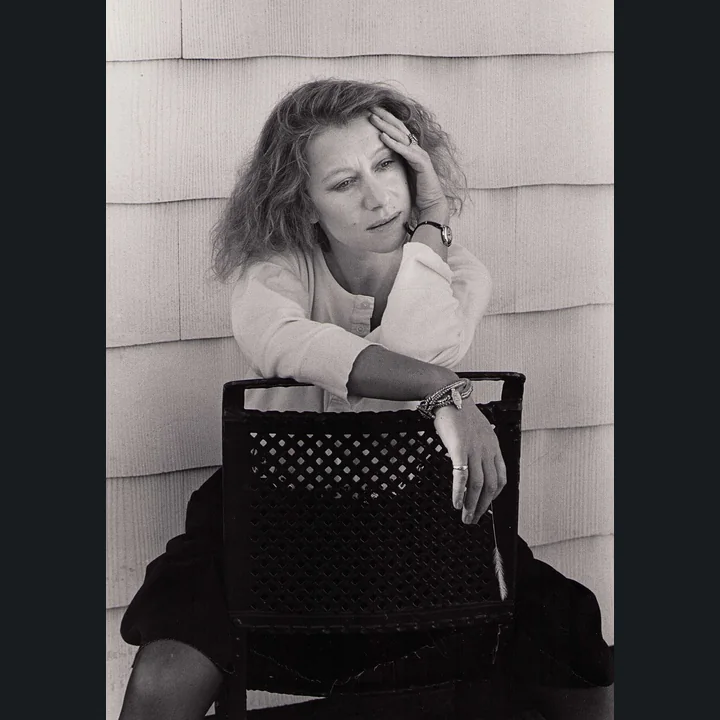 | 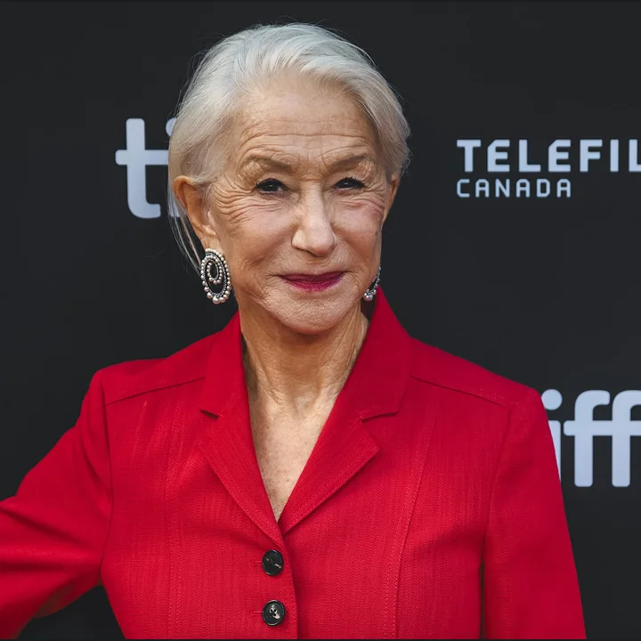 |

## Per-photo source and licence evidence

Click each image label for its archived source, original Wikimedia Commons page, copyright licence and SHA-256 file fingerprint. The page above shows exactly the processed files stored in the branch, rather than temporary ChatGPT search previews.

| Question | Question photo provenance | Answer photo provenance |
|---|---|---|
| 1 | [Original and licence](../drafts/picture-rounds/famous-faces-then-now-0001/licensed-candidates/batch3/01-question.source.json) | [Original and licence](../drafts/picture-rounds/famous-faces-then-now-0001/licensed-candidates/batch2/01-answer.source.json) |
| 2 | [Original and licence](../drafts/picture-rounds/famous-faces-then-now-0001/licensed-candidates/batch2/02-question.source.json) | [Original and licence](../drafts/picture-rounds/famous-faces-then-now-0001/licensed-candidates/batch2/02-answer.source.json) |
| 3 | [Original and licence](../drafts/picture-rounds/famous-faces-then-now-0001/licensed-candidates/batch2/03-question.source.json) | [Original and licence](../drafts/picture-rounds/famous-faces-then-now-0001/licensed-candidates/batch2/03-answer.source.json) |
| 4 | [Original and licence](../drafts/picture-rounds/famous-faces-then-now-0001/licensed-candidates/tom-jones/04-question.source.json) | [Original and licence](../drafts/picture-rounds/famous-faces-then-now-0001/licensed-candidates/tom-jones/04-answer.source.json) |
| 5 | [Original and licence](../drafts/picture-rounds/famous-faces-then-now-0001/licensed-candidates/batch3/05-question.source.json) | [Original and licence](../drafts/picture-rounds/famous-faces-then-now-0001/licensed-candidates/batch2/05-answer.source.json) |
| 6 | [Original and licence](../drafts/picture-rounds/famous-faces-then-now-0001/licensed-candidates/batch3/06-question.source.json) | [Original and licence](../drafts/picture-rounds/famous-faces-then-now-0001/licensed-candidates/batch2/06-answer.source.json) |
| 7 | [Original and licence](../drafts/picture-rounds/famous-faces-then-now-0001/licensed-candidates/batch3/07-question.source.json) | [Original and licence](../drafts/picture-rounds/famous-faces-then-now-0001/licensed-candidates/batch2/07-answer.source.json) |
| 8 | [Original and licence](../drafts/picture-rounds/famous-faces-then-now-0001/licensed-candidates/batch3/08-question.source.json) | [Original and licence](../drafts/picture-rounds/famous-faces-then-now-0001/licensed-candidates/batch2/08-answer.source.json) |
| 9 | [Original and licence](../drafts/picture-rounds/famous-faces-then-now-0001/licensed-candidates/batch3/09-question.source.json) | [Original and licence](../drafts/picture-rounds/famous-faces-then-now-0001/licensed-candidates/batch3/09-answer.source.json) |
| 10 | [Original and licence](../drafts/picture-rounds/famous-faces-then-now-0001/licensed-candidates/batch3/10-question.source.json) | [Original and licence](../drafts/picture-rounds/famous-faces-then-now-0001/licensed-candidates/batch3/10-answer.source.json) |

## Release conditions

1. Each replacement must be approved **by the exact saved file**; its SHA-256 must be locked in the final manifest, without substituting a different photograph.
2. Confirm required attribution and applicable UK reuse status. **Joan Collins' 1954 question image is labelled US public domain; this is not itself sufficient proof of UK copyright clearance**, so it stays blocked until checked or replaced.
3. Build the final 10-question/20-photo QuizPro picture round using the source-first package builder, with appropriate image credits and licence links.
4. Verify live app library import, question/answer reveal and mobile display before calling this round production-finalized.

**Existing locked review images are unchanged, and the retired David Beckham/Hugh Laurie answer images are preserved in Reviews 1–9.**
